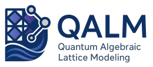

Quantum Algebra for Lattice Models and Applications (QALMA)
===========================================================

|

QALMA is a Python library for building and simulating many-body quantum
systems on lattices. It provides an efficient algebraic representation of
operators and states that exploits the tensor-product structure of lattice
Hamiltonians, mean-field and Max-Ent projected-dynamics solvers, and a bridge
between the `ALPS <https://alpscore.org>`_ XML model and lattice libraries and
`QuTiP <https://qutip.org>`_.

.. image:: https://github.com/QILPCM-IFLP-CONICET/QALMA/actions/workflows/ubuntu.yml/badge.svg
   :target: https://github.com/QILPCM-IFLP-CONICET/QALMA/actions/workflows/ubuntu.yml
   :alt: Tests

.. image:: https://github.com/QILPCM-IFLP-CONICET/QALMA/actions/workflows/check_documentation.yml/badge.svg
   :target: https://github.com/QILPCM-IFLP-CONICET/QALMA/actions/workflows/check_documentation.yml
   :alt: Docs

.. image:: https://readthedocs.org/projects/qalma/badge/?version=latest
   :target: https://qalma.readthedocs.io/en/latest/
   :alt: Documentation on Read the Docs

Features
--------

- **ALPS integration** — load models and lattice geometries directly from ALPS
  XML libraries (spin models, Bose-Hubbard, Heisenberg, custom models, chain /
  square / triangular lattices, and more). Fermionic models (spinless
  fermions, Hubbard, t-J, Kondo) are mapped to qubits with the Jordan-Wigner
  transformation, so the signs are exact.
- **Algebraic operator representation** — operators are stored as sums of
  local and few-body terms (including Pauli strings and their sums), not as
  full matrices. Memory and the cost of products, commutators and
  expectation values grow with the number of terms, not exponentially with
  the system size. Operations that need the full matrix (spectra, exact
  exponentials) are limited to small systems.
- **QuTiP interoperability** — any QALMA operator or state can be converted to
  a QuTiP ``Qobj`` with a single call, making the full QuTiP solver ecosystem
  immediately available.
- **MaxEnt projected evolution** — time-evolve density matrices projected onto
  a finite operator basis, enabling simulation of large systems beyond exact
  diagonalization.
- **Mean-field and RPA reductions** — self-consistent and variational
  mean-field approximations for Gibbs states of large systems, and reduced
  states of small subsystems with an RPA correction, with Gaussian bosonic
  states as a building block. These modules are still evolving and their
  interface may change in future releases.
- **Matrix product ground states (experimental)** — ground states of
  lattice Hamiltonians stored as matrix product states and computed with a
  built-in two-site DMRG, with the same state interface as Gibbs states.
- **Symbolic algebra** — operators support addition, multiplication,
  commutators, exponentiation, traces, and partial traces out of the box.
- **Safe HDF5 storage** — systems, operators, states and simulations are
  saved in a documented HDF5 format that does not use Python pickles.

Installation
------------

QALMA needs Python 3.11 or newer. Install the latest release from PyPI with::

    pip install qalma

The plotting helpers need `matplotlib`, which is installed with the ``plot``
extra (``pip install "qalma[plot]"``).

To get the development version, install directly from the GitHub repository.
For a clean setup it is recommended to use a virtual environment::

    python -m venv qalma_env
    source qalma_env/bin/activate          # macOS / Linux
    # .\qalma_env\Scripts\activate.bat     # Windows Command Prompt
    pip install git+https://github.com/QILPCM-IFLP-CONICET/QALMA/

Quick example
-------------

.. code-block:: python

    import numpy as np
    import qutip
    from qalma import build_system

    # Spin-1/2 Heisenberg chain; by default, 4 sites ("chain lattice", "spin")
    system = build_system()

    H = system.global_operator("Hamiltonian")
    Sz = system.global_operator("Sz")

    # Algebraic manipulation: no explicit matrices needed
    Htotal = (H - 2 * Sz).simplify()
    print("Lowest levels:", Htotal.eigenenergies()[:4])

    # Convert to QuTiP and evolve (exact methods: small systems only)
    rho0 = (-Htotal).expm()
    rho0 = rho0 / rho0.tr()
    result = qutip.mesolve(
        H=Htotal.to_qutip(),
        rho0=rho0.to_qutip(),
        tlist=np.linspace(0, 10, 200),
        e_ops=[Sz.to_qutip()],
    )

See the `examples <https://qalma.readthedocs.io/en/latest/user/examples.html>`_
in the documentation for more complete walkthroughs.

Documentation
-------------

The documentation (user guide, API reference and examples) is at
https://qalma.readthedocs.io. Its sources live in the ``docs/`` directory;
to build them locally::

    pip install -e ".[docs]"
    cd docs
    make html

Citing
------

If you use QALMA in your research, please cite it using the metadata in
``CITATION.cff`` (GitHub shows it under "Cite this repository").

License
-------

QALMA is free software: you can redistribute it and/or modify it under the
terms of the `GNU Lesser General Public License, version 3 (LGPL-3.0)
<COPYING.LESSER>`_, which supplements the `GNU General Public License,
version 3 <COPYING>`_. In short: you can use QALMA from code under any
license, but distributed modifications of QALMA itself must remain under the
LGPL.

The model and lattice libraries in ``qalma/lib/*.xml`` come from the
`ALPS project <https://alpscore.org>`_ and are distributed under the
`Boost Software License 1.0 <qalma/lib/LICENSE_1_0.txt>`_.
